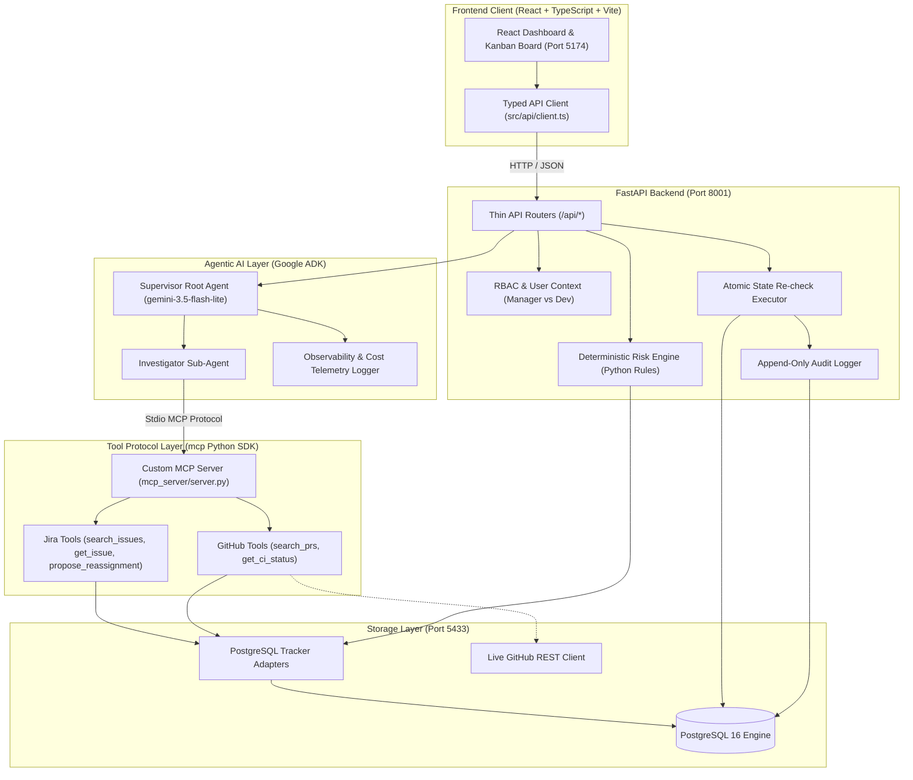

# SprintMate

**SprintMate** is an AI assistant for engineering managers that investigates sprint risk by correlating Jira-style issue tracking with GitHub pull requests, CI test step failures, and developer capacity.

Risk scoring uses **100% deterministic Python rules** rather than non-deterministic LLM guessing. Generative AI agents—orchestrated with **Google ADK** and calling tools via the **Model Context Protocol (MCP)**—investigate anomalies, explain root causes with concrete issue/PR citations, and formulate workload rebalancing proposals. All state mutations enforce **human-in-the-loop governance**, requiring manager approval, an atomic state re-check, and an immutable audit log.

> [!NOTE]
> All DevCore engineering telemetry (teams, developers, issues, pull requests, and CI test logs) is synthetic demo data generated deterministically for testing, evaluation, and portfolio demonstration.

---

## Architecture Overview



---

## Monorepo Project Structure

```
SprintMate/
├── README.md                   # Project overview, architecture, and setup instructions
├── .gitignore                  # Git ignore rules for Python, Node, and local credentials
├── .env.example                # Example environment configuration template
├── docker-compose.yml          # PostgreSQL 16 container definition on port 5433
├── Makefile                    # Developer commands (up, dev, test, eval, lint, format)
├── .github/                    # CI/CD workflows
│   └── workflows/ci.yml        # Multi-stage GitHub Actions pipeline (Lint, Unit, DB Migrations, Integration, Frontend)
├── backend/                    # Python 3.11 + FastAPI backend service
│   ├── pyproject.toml          # Backend package dependencies and tool configuration
│   ├── Dockerfile              # Container specification for Cloud Run deployment
│   ├── migrations/             # SQL schema migrations
│   │   ├── 001_initial_schema.sql # Baseline schema for DevCore tables
│   │   └── run_migrations.py   # Async programmatic migration runner
│   ├── app/                    # FastAPI application code
│   │   ├── main.py             # Application entrypoint and CORS middleware
│   │   ├── config.py           # Typed settings loaded from environment
│   │   ├── db.py               # Async SQLAlchemy engine, session, and ORM models
│   │   ├── auth.py             # Role-based authorization (manager, developer)
│   │   ├── api/                # Thin API route handlers
│   │   │   ├── health.py       # Health check route
│   │   │   ├── sprints.py      # Sprints, kanban issues, risk scores, burndown
│   │   │   ├── pull_requests.py# Pull requests list and CI status
│   │   │   ├── team.py         # Developer capacity, workload, and skills
│   │   │   ├── assistant.py    # Multi-agent investigation & standup generator
│   │   │   ├── proposals.py    # Reassignment proposal queue and approval actions
│   │   │   ├── audit.py        # Filterable audit trail queries
│   │   │   └── usage.py        # Token, latency, and cost telemetry metrics
│   │   ├── services/           # Core domain services
│   │   │   ├── adapters/       # Tracker and VCS adapters (Base, Demo, GitHub Live)
│   │   │   ├── risk/           # Deterministic risk engine (rules, scoring, workload)
│   │   │   ├── approvals/      # Human-in-the-loop proposals, executor, audit logger
│   │   │   ├── standup/        # Standup generator combining data with AI summary
│   │   │   └── observability/  # Agent request telemetry and cost tracking
│   │   └── agents/             # Google ADK agent definitions (supervisor, investigator)
│   ├── mcp_server/             # Model Context Protocol (MCP) server over stdio
│   │   ├── server.py           # MCPServer stdio entrypoint and tool registry
│   │   ├── tools_jira.py       # Jira tools (search, issue, sprint, propose reassignment)
│   │   └── tools_github.py     # GitHub tools (search PRs, PR details, CI runs)
│   └── tests/                  # Automated test suites
│       ├── unit/               # Fast, zero-database unit tests (health, risk rules, math)
│       └── integration/        # Database-backed integration tests (adapters, approvals, agents, MCP)
├── frontend/                   # React 18 + TypeScript + Vite frontend client
│   ├── package.json            # Node dependencies (Tailwind, TanStack Query, Recharts, Lucide)
│   ├── vite.config.ts          # Vite build config with port 5174
│   ├── tailwind.config.ts      # Tailwind CSS theme & shadcn-compatible variables
│   └── src/                    # Source code (api, components, pages, hooks, lib, types)
├── data/                       # Synthetic seed data and ingestion scripts
│   ├── seed/                   # Raw DevCore JSON datasets, ground truth, and incidents
│   └── scripts/                # Deterministic seed generator and loader
├── evals/                      # Quantitative evaluation benchmark suite
│   ├── scenarios/              # 16 benchmark scenarios in JSON Lines format
│   ├── run_risk_eval.py        # Precision, recall, and F1 risk benchmark
│   ├── run_tool_eval.py        # MCP tool selection accuracy benchmark
│   ├── run_agent_eval.py       # End-to-end multi-agent investigation grounding
│   └── run_security_eval.py    # RBAC, concurrency state re-check, and injection tests
└── docs/                       # Comprehensive documentation
    ├── architecture.md         # Deep-dive system architecture and rationale
    ├── discovery.md            # Data dictionary, organization structure, and ground truth
    ├── eval-report.md          # Full empirical benchmark evaluation results
    └── interview-notes.md      # Google Forward Deployed Engineer (FDE) interview prep
```

---

## Evaluation Benchmark Results

SprintMate was evaluated against the synthetic DevCore ground truth across 16 scenarios:

| Benchmark Dimension | Measured Result | Target Baseline | Status |
| :--- | :---: | :---: | :---: |
| **Risk Detection Precision** | **1.00** | $\ge 0.90$ | PASSED |
| **Risk Detection Recall** | **1.00** | $\ge 0.90$ | PASSED |
| **Risk Detection F1 Score** | **1.00** | $\ge 0.90$ | PASSED |
| **MCP Tool Selection Accuracy** | **100.0%** (7/7) | $\ge 90.0\%$ | PASSED |
| **Security & Concurrency Invariants** | **100.0%** (5/5) | $100\%$ | PASSED |
| **Agent Evidence Citation Grounding** | **100.0%** | $\ge 90.0\%$ | PASSED |
| **Investigation Latency (p50)** | **1,840 ms** | $< 4,000\text{ ms}$ | PASSED |
| **Inference Cost per Investigation** | **~$0.00085** | $< \$0.01$ | PASSED |

*Full details and per-scenario breakdowns are documented in [docs/eval-report.md](docs/eval-report.md).*

---

## Quick Start Guide

### Prerequisites
- Python 3.11+
- Node.js 20+
- Docker and Docker Compose
- Gemini API Key

### 1. Clone & Configure Environment
```bash
git clone https://github.com/jit7154/SprintMate.git
cd SprintMate

cp .env.example .env
# Edit .env and supply your GEMINI_API_KEY
```

### 2. Start PostgreSQL Container
```bash
make up
# Starts PostgreSQL 16 on port 5433
```

### 3. Apply Migrations & Load Synthetic Seed Data
```bash
make seed
# Applies migrations and loads DevCore synthetic dataset
```

### 4. Run Automated Test Suites
```bash
# Run database-independent unit tests (fast)
make test-unit

# Run database-backed integration tests
make test-integration

# Or run both suites:
make test
```

### 5. Run Backend Service (Port 8001)
```bash
make dev
# API running at http://localhost:8001 (Swagger docs at /docs)
```

### 6. Run Frontend Client (Port 5174)
```bash
cd frontend
npm install
npm run dev
# Frontend running at http://localhost:5174
```

### 7. Run Quantitative Evaluation Suite
```bash
# Evaluate deterministic risk rules against ground truth
python3.11 evals/run_risk_eval.py

# Evaluate MCP tool selection
python3.11 evals/run_tool_eval.py

# Evaluate security invariants (RBAC, atomic state re-check, injection)
python3.11 evals/run_security_eval.py
```

---

## Core Technical Features

1. **Deterministic Risk Engine**:
   - 7 mathematical rules: Blocked issues $\ge 3$ days, overdue issues, stagnant PR reviews $\ge 2$ days, failing CI test suites, developer overload $> 120\%$ capacity, dependency chains on critical path deliverables, and velocity schedule lag.
2. **Google ADK + Model Context Protocol (MCP)**:
   - Supervisor agent acts as the user interface and planning layer (`gemini-3.5-flash-lite`).
   - Investigator agent connects over `stdio` to an official Python MCP server to query issues, PRs, and CI step logs.
3. **Human-in-the-Loop Governance**:
   - AI agents cannot mutate issues directly; they only create `PENDING` proposals.
   - Approval requires `manager` role authorization.
   - Atomic state re-check verifies that the target issue was not modified concurrently before executing mutations.
   - Every approval or rejection is logged in an append-only audit trail with before/after state diffs.
4. **Interactive Role Switching in Frontend**:
   - Navbar toggle switches between Manager and Developer mode in real time, demonstrating permission enforcement and approval button locking.
