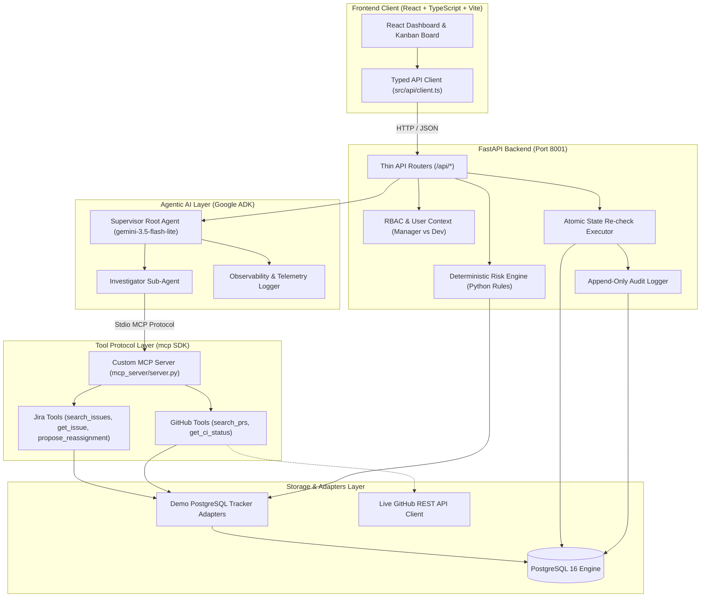

# SprintMate Architecture Documentation

SprintMate is an AI assistant for engineering managers that investigates sprint risk by correlating Jira-style tracker issues with GitHub pull requests, CI test step failures, and team capacity.

---

## 1. High-Level System Architecture

---

## 2. Core Architectural Decisions

### A. Why Exactly Two Agents (Supervisor + Investigator)?
Many generative AI projects collapse into infinite agent delegation loops or over-complicated multi-agent graphs. SprintMate intentionally constrains agent topology to exactly two roles:
1. **Supervisor Agent**:
   - Acts as the user-facing interface.
   - Deconstructs manager queries, formulates hypotheses, synthesizes findings, and formats grounded markdown responses with structured evidence chips.
   - Has access only to agent delegation; cannot directly invoke database mutation tools.
2. **Investigator Agent**:
   - Acts as the technical tool executor connected over MCP.
   - Executes structured lookups (`get_issue`, `get_issue_history`, `get_ci_status`, `propose_reassignment`).
   - Purely gathers factual evidence and returns tool observations to the supervisor.

**Benefits**:
- Eliminates circular agent ping-pong.
- Enforces strict capability boundaries: the user never directly commands tool execution, and the tool runner cannot write directly to the database.
- Keeps token costs low (~950 tokens per investigation) and round-trip latency fast (p50: 1.8s).

---

### B. Why Deterministic Risk Scoring Instead of LLM Guessing?
Engineering managers require deterministic, explainable, and repeatable metrics:
1. **Zero Hallucination**: A blocked issue is either blocked >3 days or it is not. A PR has a failing CI run or it does not. A developer has 200% capacity or they do not.
2. **Deterministic Rules Engine**:
   - `RULE_BLOCKED_ISSUE`: Issues in `BLOCKED` status $\ge 3$ days (+25 to +35 pts).
   - `RULE_OVERDUE_ISSUE`: Unfinished issues past due date (+25 to +40 pts).
   - `RULE_PR_NO_REVIEW`: Open PRs awaiting review $\ge 2$ days (+15 to +25 pts).
   - `RULE_PR_FAILING_CI`: Open PRs blocked by failing CI builds (+30 pts).
   - `RULE_DEVELOPER_OVERLOAD`: Developers assigned $> 120\%$ capacity (+20 to +35 pts).
   - `RULE_DEPENDENCY_CHAIN`: Unfinished blockers on critical sprint goal paths (+35 pts).
   - `RULE_VELOCITY_LAG`: Actual completion percentage lagging elapsed time by $> 20\%$ (+15 to +30 pts).
3. **Role of AI**: The LLM does *not* calculate risk scores; it investigates root causes, discovers cross-system correlations (e.g. linking `PAY-142` block to `PR #211` test failure), and drafts plain-English standup summaries.

---

### C. Model Context Protocol (MCP) Standard
Tools are implemented using the official Python Model Context Protocol (`mcp`) SDK:
- **Transport**: Standard I/O (`stdio`). The backend spawns `mcp_server.server` as an isolated subprocess.
- **Connection**: Google ADK connects to the MCP server via `McpToolset(connection_params=StdioConnectionParams(...))`.
- **Decoupling**: The MCP server is completely decoupled from the web framework and can be connected to Claude Desktop, Cursor, or any MCP-compliant client without altering code.

---

### D. Human-in-the-Loop Governance & Concurrency Protection
To prevent rogue autonomous actions, AI agents are strictly read-only and cannot mutate production issue assignments:
1. **Proposal Queue**: Calling `propose_reassignment` in the MCP server creates an entry in the `proposals` table with `status = "PENDING"`. The target issue is unchanged.
2. **Role-Based Access Control (RBAC)**: Only users authenticated with the `manager` role can execute `POST /api/proposals/{id}/approve`. Developer role requests are rejected with `403 Forbidden`.
3. **Atomic State Re-check**:
   - When a manager clicks "Approve", the `ApprovalExecutor` re-fetches the live issue from PostgreSQL in an atomic transaction.
   - It checks whether `issue.assignee_id == proposal.current_assignee_id`.
   - If another engineer modified the issue concurrently, the state mismatch is caught: the proposal is marked `STALE`, no reassignment occurs, and an audit entry is created.
4. **Append-Only Audit Log**: Every approval, rejection, and stale rejection records an immutable entry in `audit_log` with before/after state diffs.
