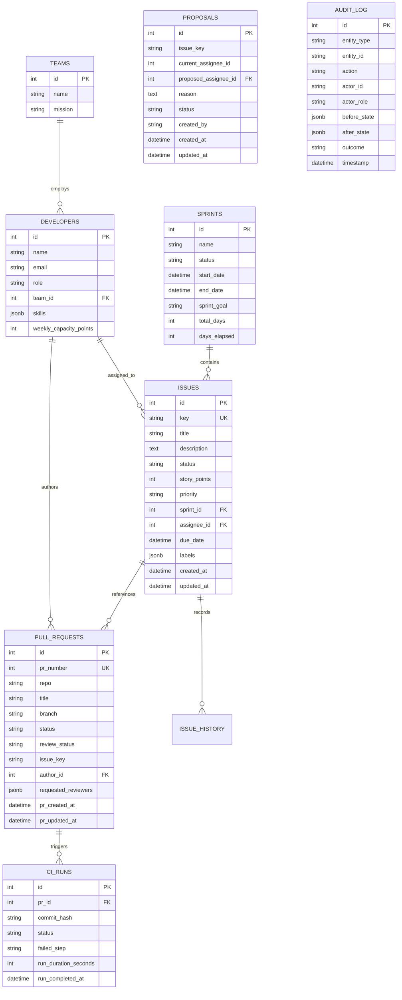

# DevCore Workspace Discovery & Data Dictionary

## 1. Overview
SprintMate operates on synthetic engineering telemetry representing **DevCore**, a mid-stage B2B SaaS organization providing payment orchestration and developer platforms.

The dataset includes 3 engineering teams, 12 engineers with varied skill competencies, 3 two-week sprints (Sprint 23 completed, Sprint 24 active at Day 8 of 10, Sprint 25 upcoming), 60 tracked issues, 30 pull requests with linked CI run status, and 5 historical postmortem incident reports.

> [!NOTE]
> All DevCore data is synthetic, generated deterministically via `data/scripts/generate_seed.py` and loaded into PostgreSQL via `data/scripts/load_seed.py`.

---

## 2. Organization Structure

### Teams
| Team ID | Team Name | Prefix | Focus Area |
| :--- | :--- | :--- | :--- |
| **1** | Core Platform | `CORE` | Infrastructure, database connection pooling, authentication, caching, OTel telemetry. |
| **2** | Payments & Billing | `PAY` | Stripe webhooks, recurring charge retry engine, SEPA debit, invoicing reconciliation. |
| **3** | Customer Experience | `CX` | Merchant web portal, payment history UI, discrepancy alerts, CSV audit export. |

### Developers Roster
| ID | Name | Role | Team | Weekly Capacity | Key Skills |
| :--- | :--- | :--- | :--- | :--- | :--- |
| **1** | Alex Rivera | Manager | Core Platform | 10 pts | `python`, `devops`, `postgres`, `fastapi`, `architecture` |
| **2** | Sarah Chen | Developer | Core Platform | 8 pts | `devops`, `kubernetes`, `terraform`, `aws`, `docker` |
| **3** | Marcus Johnson | Developer | Core Platform | 8 pts | `python`, `redis`, `docker`, `fastapi` |
| **4** | Priya Sharma | Developer | Core Platform | 6 pts | `python`, `fastapi`, `testing`, `postgres` |
| **5** | Elena Rostova | Developer | Payments & Billing | 8 pts | `payments`, `python`, `postgres`, `stripe`, `webhooks` |
| **6** | David Kim | Developer | Payments & Billing | 8 pts | `payments`, `security`, `go`, `python`, `idempotency` *(Overloaded: 16 pts)* |
| **7** | Rachel Green | Developer | Payments & Billing | 7 pts | `payments`, `webhooks`, `python`, `fastapi`, `stripe` *(Available capacity)* |
| **8** | Tom Bradley | Developer | Payments & Billing | 5 pts | `python`, `testing`, `fastapi`, `sql` |
| **9** | Maya Lin | Developer | Customer Experience | 10 pts | `react`, `typescript`, `tailwind`, `ui/ux`, `frontend` |
| **10** | Leo Martinez | Developer | Customer Experience | 8 pts | `react`, `typescript`, `recharts`, `dashboard` |
| **11** | Chloe Dupont | Developer | Customer Experience | 8 pts | `react`, `python`, `fastapi`, `fullstack` |
| **12** | Samira Khan | Developer | Customer Experience | 5 pts | `react`, `css`, `html`, `javascript` |

---

## 3. Data Dictionary

### Entity Relationship Diagram

---

## 4. Deliberately Seeded Anomalies (Sprint 24)

The evaluation suite validates the deterministic risk engine against ground truth seeded into Sprint 24:

1. **Blocked Issue (`PAY-142`):**
   - Title: "Retry failed recurring payments engine" (5 points, High Priority).
   - Status: `BLOCKED` for 4 days (exceeds standard 3-day threshold).
   - Dependency: Blocked by `PAY-139`.

2. **Overdue Critical Issue (`PAY-139`):**
   - Title: "Stripe idempotency key race condition in webhook worker" (5 points, Critical Priority).
   - Status: `IN_PROGRESS`.
   - Due Date: 2 days in the past (`BASE_DATE - 2 days`).
   - Assignee: David Kim.

3. **Overloaded Developer (David Kim):**
   - Weekly Point Capacity: 8 points.
   - Assigned Active Sprint Points: 16 points (`PAY-139`: 5, `PAY-141`: 5, `PAY-145`: 3, `PAY-148`: 3).
   - Workload ratio: 200%.

4. **Stuck Pull Request Without Review (`PR #204`):**
   - Linked Issue: `PAY-145`.
   - Age: 4 days without review feedback.
   - Review Status: `PENDING_REVIEW`.

5. **Pull Request With Failing CI (`PR #211`):**
   - Linked Issue: `CORE-108`.
   - Author: Sarah Chen.
   - CI Status: `FAILURE` in step `test_pool_saturation`.

6. **Critical Dependency Chain Threatening Sprint Goal (`PAY-150`):**
   - Deliverable: "Unified merchant webhook reconciliation - Sprint Goal deliverable" (8 points).
   - Dependency Chain: `PAY-150` -> `PAY-142` -> `PAY-139`.
   - Root Blocker: `PAY-139` is overdue and assigned to an overloaded developer.

---

## 5. Incident Knowledge Base
Five historical incident postmortems are stored under `data/seed/incidents/`:
- `INC-2024-01`: Stripe Webhook Delivery Timeout under High Load
- `INC-2024-02`: Idempotency Key Race Condition in Payment Retry Engine
- `INC-2024-03`: Auth Token Cache Invalidation Cascading Failure
- `INC-2024-04`: Database Connection Pool Exhaustion in Worker Tier
- `INC-2024-05`: Payment Service Circuit Breaker Flapping
